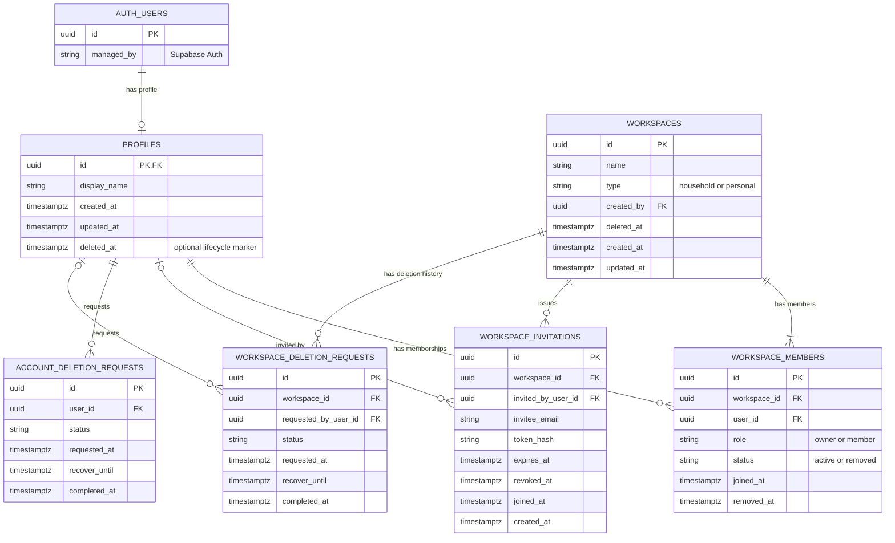
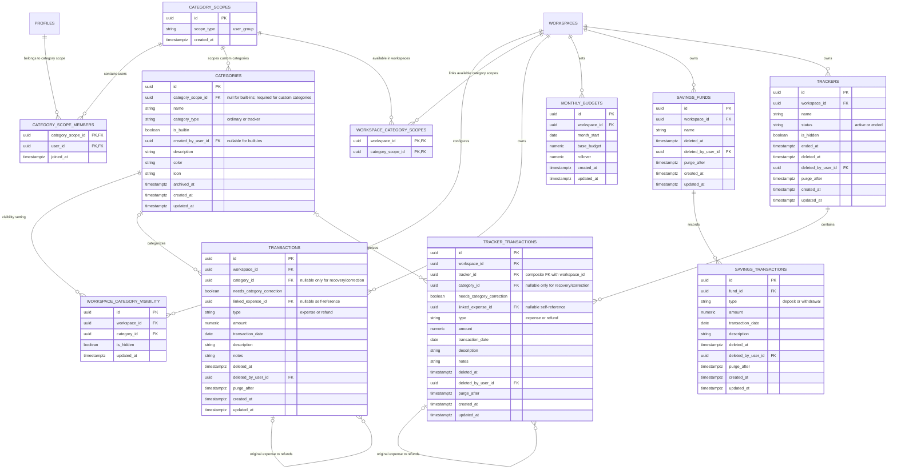
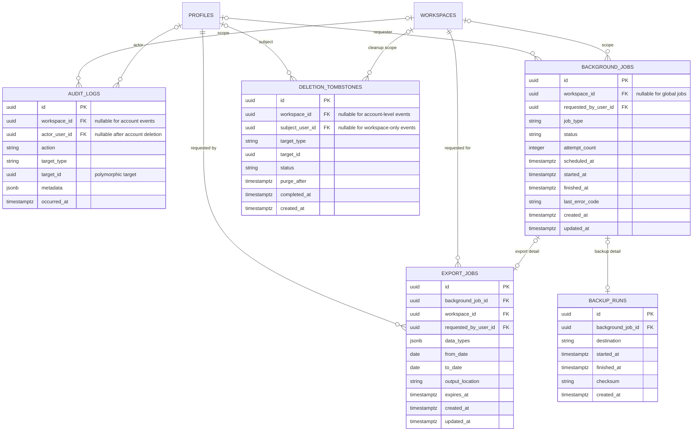

# Budgetly — Artifact 1: Entity Relationship Diagram (ERD)

**Status:** Stage 4 design baseline complete; ERD is design-only and does not authorize migrations  
**Based on:** Approved Stage 4 Database and API Design specification  
**Database target:** Supabase PostgreSQL  
**Business timezone:** `Asia/Kolkata`  
**Money:** `numeric(14,2)`; never floating point  
**IDs:** UUIDs unless otherwise stated

## 1. Purpose and scope

This ERD turns the approved Stage 4 table inventory and business rules into a proposed relational model. It is a review artifact, not an implemented database schema. Exact column definitions, constraints, indexes, triggers/functions, and RLS policies belong to the next artifact.

The diagram is split into three smaller diagrams for readability:

1. Identity, workspaces, membership, invitations, and deletion requests.
2. Financial data and explicit household-user category scopes.
3. Audit, single-source background jobs, per-user exports, backups, idempotency, and deletion cleanup.

## 2. Identity and workspace relationships

### Relationship and lifecycle notes

- `PROFILES.id` should match the corresponding Supabase Auth user ID; Supabase Auth remains the source of authentication credentials and sessions.
- `WORKSPACE_MEMBERS` is the membership join table. A user can belong to multiple workspaces; a workspace has one or more memberships.
- Approved membership model: a Personal workspace is private and has one active owner/member. A Shared Household may have flexible membership beyond two members but must have exactly one owner. Enforce membership and ownership invariants transactionally; do not impose a two-member household limit. Removing or transferring ownership must not leave an invalid owner state.
- Invitations store a hash of the secret token, not the raw token. Joining must check verified identity, expiry, and revocation atomically.
- Removing a member should revoke access without deleting shared financial data.
- Deletion request tables retain lifecycle state for the 30-day recovery period. Permanent cleanup must be idempotent.
- A workspace owner is represented by `WORKSPACE_MEMBERS.role = 'owner'`; avoid maintaining a second independent owner field unless there is a reviewed reason to do so.

## 3. Financial data relationships

### Relationship and business-rule notes

- `TRANSACTIONS` represents ordinary workspace expenses and refunds. A refund is another row with `type = 'refund'`; `linked_expense_id` optionally references the original expense in the same table.
- `TRACKER_TRANSACTIONS` is separate so tracker records and their category type remain independent of the household monthly budget. It stores both `workspace_id` and `tracker_id`; enforce consistency with a composite foreign key from `(workspace_id, tracker_id)` to a unique `(workspace_id, id)` key on `TRACKERS`. This supports workspace-scoped RLS while preventing cross-workspace tracker references. It uses the same expense/refund pattern within a tracker.
- For linked refunds, enforce that the referenced row is an expense, belongs to the same workspace/tracker, and that total active linked refunds never exceed the original expense. The aggregate limit needs a transactional database function/locking strategy; a simple `CHECK` constraint cannot enforce it.
- A transaction normally requires a compatible category. **Decision confirmed:** when a trashed transaction is restored after its category was permanently deleted, allow `category_id = NULL` and set `needs_category_correction = true` until the user assigns a replacement. Apply the same policy to tracker transactions if they can encounter the same recovery scenario; category compatibility still applies whenever `category_id` is non-NULL.
- `MONTHLY_BUDGETS.month_start` represents the first calendar day of a month. Enforce one budget per workspace and month. Budget totals are derived from eligible transactions/refunds rather than stored as duplicated totals.
- `SAVINGS_TRANSACTIONS` belongs to a fund; deposits and withdrawals determine the balance. Savings transactions do not count toward budgets or trackers.
- `TRACKERS.status` and `is_hidden` are separate concepts: a tracker can be active/ended and independently visible/hidden. Deleting a tracker moves it and its transaction rows to Trash together.
- `CATEGORIES` are a catalog of globally readable built-ins and household-user-scoped custom definitions. **D1 approved Option A: custom category definitions are shared across the relevant users' Personal and Shared Household workspaces, not app-wide.** Category custom names are unique case-insensitively within a category scope after trimming; archived custom names remain reserved. Ordinary and tracker categories are separated by `category_type`. Built-in category visibility overrides are scoped to a workspace.
- A deleted category may be physically removed only when the approved reference rules permit it. If a transaction is restored after its category was removed, it must be flagged for category correction.
- Monetary columns should be `numeric(14,2)`. Add positive-amount constraints and type-specific checks in the schema artifact.

## 4. Audit, jobs, exports, backups, and cleanup relationships

### Operational notes

- `AUDIT_LOGS.target_type` + `target_id` is intentionally polymorphic. It cannot use a normal foreign key to every possible target table. Application/database functions must validate targets and enforce retention rules.
- `BACKGROUND_JOBS` is the approved common job queue. `EXPORT_JOBS` and `BACKUP_RUNS` hold job-specific details and refer to a background job. Shared queue lifecycle fields (status, attempts, scheduling, and safe error metadata) belong in `BACKGROUND_JOBS`; task-specific settings and results belong in the detail tables.
- Export records must be workspace-scoped and re-authorized at download time. Do not rely only on an old signed URL to preserve access after a member is removed.
- **Decision confirmed: dedicated deletion tombstones.** Maintain a durable `DELETION_TOMBSTONES` ledger for account/workspace deletion and permanent-purge operations. `workspace_id` is nullable for account-level events; `subject_user_id` is nullable for workspace-only events. Use it to make cleanup retries idempotent and reconcile backup recovery so purged data is not resurrected. Ordinary Trash items continue to use their own soft-delete fields; tombstones do not replace the Trash model.
- **Decision confirmed: per-record Trash fields, no centralized Trash-item table.** Trash-eligible records carry their own soft-delete metadata, including `deleted_at`, the deleting actor where available, and a 30-day `purge_after` deadline. The unified Trash view combines supported record types at query/service level. Related-record operations (expense plus linked refunds; tracker plus tracker transactions) must be atomic. A savings fund's soft-delete behavior must preserve the approved rule that its retained transactions remain included in its balance until permanent deletion.
- Store only safe error codes and metadata in logs. Do not store OTPs, raw invitation tokens, session tokens, or secrets.

## 5. Key cardinalities at a glance

| Relationship                                     | Cardinality                   | Notes                                                                                                                                              |
| ------------------------------------------------ | ----------------------------- | -------------------------------------------------------------------------------------------------------------------------------------------------- |
| Auth user → profile                              | 1 to 0/1                      | Profile ID mirrors Supabase Auth user ID.                                                                                                          |
| User ↔ workspace                                 | many-to-many via membership   | Access is determined by active membership.                                                                                                         |
| Workspace → invitations                          | 1 to many                     | Invitations expire in 7 days and can be revoked.                                                                                                   |
| Workspace → transactions                         | 1 to many                     | Ordinary expenses/refunds.                                                                                                                         |
| Expense → linked refunds                         | 1 to many                     | Refund points to its original expense; total linked refunds are capped.                                                                            |
| Workspace → monthly budgets                      | 1 to many                     | Unique per workspace/month.                                                                                                                        |
| Workspace → savings funds → savings transactions | 1 to many at each step        | Fund balance is derived.                                                                                                                           |
| Workspace → trackers → tracker transactions      | 1 to many at each step        | Tracker transactions are separate from budget transactions and store `workspace_id` plus `tracker_id`; a composite FK enforces matching ownership. |
| Category → transactions                          | 1 to many                     | Category type must match transaction domain.                                                                                                       |
| Workspace → category visibility                  | 1 to many                     | Unique per workspace/category.                                                                                                                     |
| Workspace/user → audit logs                      | 1 to many                     | Actor may be null after account deletion.                                                                                                          |
| Background job → export/backup detail            | 1 to 0/1 for each detail type | Approved shared job model; each job should have at most one detail row of each supported type, with task type validated for consistency.           |
| Trash-eligible record → deletion metadata        | Per record                    | Store soft-delete state on the record; no central Trash-item table. Combine types for the unified Trash view.                                      |

## 6. Decisions log — all seven modeling decisions resolved

1. **Custom category scope — RESOLVED by D1.** Custom category definitions use per-user `CATEGORY_SCOPES` and `CATEGORY_SCOPE_MEMBERS`; `WORKSPACE_CATEGORY_SCOPES` links a personal workspace to its owner's scope and a household workspace to each active member's scope. Unrelated Budgetly users cannot read or use them. Names are unique case-insensitively within a scope, including archived names; built-in names remain globally reserved. Built-in category visibility overrides remain workspace-specific.
2. **Restored transaction with a deleted category — RESOLVED.** A restored transaction may have `category_id = NULL` and `needs_category_correction = true` when its original category was permanently deleted. The flag is cleared only after assigning a valid replacement category. The same recovery behavior applies to tracker transactions. Category compatibility is enforced whenever `category_id` is non-NULL.
3. **Workspace membership — RESOLVED.** Personal workspaces have one active owner/member. Household workspaces may have more than two active members but must have exactly one owner. No two-member cap. Membership and ownership changes must be transactional.
4. **Tracker transaction workspace ownership — RESOLVED.** Store both `workspace_id` and `tracker_id` on tracker transactions. Enforce matching ownership with a composite foreign key from `(workspace_id, tracker_id)` to a unique `(workspace_id, id)` key on `TRACKERS`.
5. **Background jobs — RESOLVED.** Use one `background_jobs` queue. `export_jobs` and `backup_runs` hold task-specific details. Shared status, scheduling, retry, and safe error metadata live in the queue; task parameters and results live in detail tables.
6. **Deletion tombstones — RESOLVED.** Maintain a durable `deletion_tombstones` ledger for account/workspace deletion and permanent-purge operations, supporting idempotent cleanup and backup-recovery reconciliation. Ordinary Trash remains separate.
7. **Trash representation — RESOLVED.** Use per-record soft-delete fields on each Trash-eligible table. The unified Trash screen combines supported record types without a centralized Trash-item table. Related-record deletion/restoration must be transactional, and ordinary Trash records use a 30-day recovery deadline.

### Consistency checks before schema design

- The `needs_category_correction` field is explicitly present on both ordinary and tracker transaction entities.
- A custom category can be referenced by records in workspaces assigned to its category scope; RLS must authorize both the workspace and the category scope. Built-in categories remain global.
- The tracker composite foreign key must be supported by a matching unique constraint on `TRACKERS(workspace_id, id)`.
- The common job queue and its detail tables must enforce one compatible detail type per job (for example, an export job cannot also be a backup run).
- Account-level tombstones must be representable without a workspace ID, and workspace-level tombstones without a user subject; therefore those reference columns are nullable when the target type does not require them.
- Ordinary Trash metadata belongs on each eligible record, not in a second index table. `purge_after` should be computed consistently from deletion time plus the 30-day retention period; early permanent deletion remains a separately confirmed operation.
- Audit retention and privacy rules still apply: financial audit entries are removed when their associated financial record is permanently purged; shared audit history uses a “Deleted user” label where appropriate.
- These are ERD-level rules. Exact constraint implementation, trigger/function design, index definitions, and RLS policy logic are specified in Artifacts 2–3 and remain subject to implementation-time static review and tests.

## 7. Reconciled decisions and cross-artifact rules

- **Custom category scope (D1, approved Option A):** custom categories belong to a household-user category scope, shared by the relevant users across their Personal and Shared Household workspaces. They are not app-wide. Model this with per-user `CATEGORY_SCOPES`, `CATEGORY_SCOPE_MEMBERS`, and the many-to-many `WORKSPACE_CATEGORY_SCOPES` link; built-ins remain global. Custom names are case-insensitively unique after trimming within a scope, and built-in names remain reserved globally. Scope membership and workspace-scope links change transactionally. Do not merge category rows on household join; disambiguate same-named categories from different scopes by category owner in the UI.
- **Annual Drive exports (D2, approved Option A):** create an independently authorized export for each user and each workspace they may access, writing to that user's own authorized Drive destination. Shared Household exports may be duplicated for the two users.
- **Idempotency (D3):** retain retry-sensitive mutation keys for at least 24 hours, with request fingerprint and replay metadata; pending jobs retain keys until terminal plus at least 24 hours.
- **Pagination (D4):** cursor pagination for transactions/history and large changing collections; page-number pagination for simple lists/reports. Default page size 20, maximum 100. An endpoint uses exactly one pagination style.
- **Job lifecycle:** `BACKGROUND_JOBS.status` is authoritative. Export/backup detail tables contain task-specific parameters/results and do not own an independently writable lifecycle status.

## 8. Recommended review checklist

The ERD design baseline is complete; the remaining checks are implementation-time verification gates. This document records the seven ERD decisions and reconciled D1–D14 defaults. In particular, check household-user category scopes, per-user Drive exports, mixed pagination, idempotency retention, linked refunds, savings independence, tracker isolation, shared background job processing, tombstone-based purge reconciliation, and 30-day Trash recovery.

**Stage 4 status:** ERD design complete. No PostgreSQL migrations or production database changes have been made. Any migration execution still requires separate explicit approval.

## 8. Reconciliation addendum — selected low-complexity category model

Use one category scope per user, and a many-to-many `workspace_category_scopes` association. A personal workspace links only to its owner's scope; a household workspace links to each active member's scope. `category_scope_members` controls who can access/manage each scope. On household join/leave, update scope membership and workspace-scope links atomically. Do not merge category records or rewrite historical transaction references.

Same-named custom categories may exist in different user scopes. The UI must disambiguate collisions with the category owner's display name; reports continue to group by category ID. Built-in category names remain globally reserved. Scope access must not be inferred from creator ID alone.

`background_jobs` is the sole lifecycle status source. Export and backup detail rows contain task parameters/results only. Per-user annual exports use each recipient's private Drive destination and authenticated Budgetly links. These are design decisions only; no schema has been executed.
